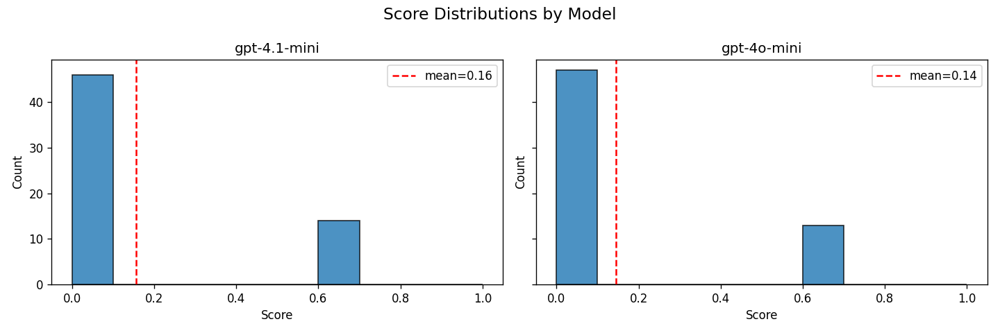
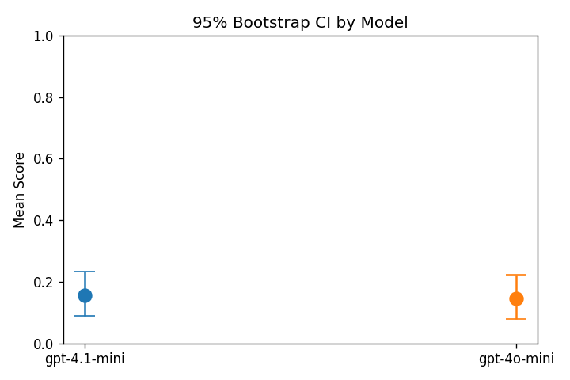
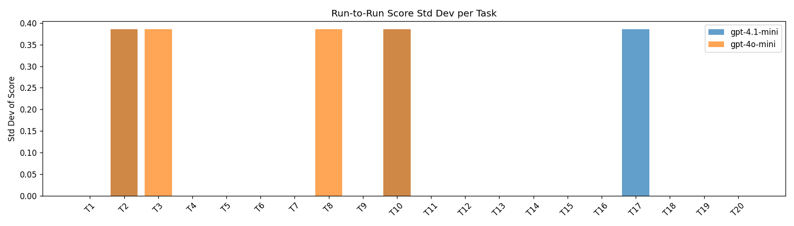
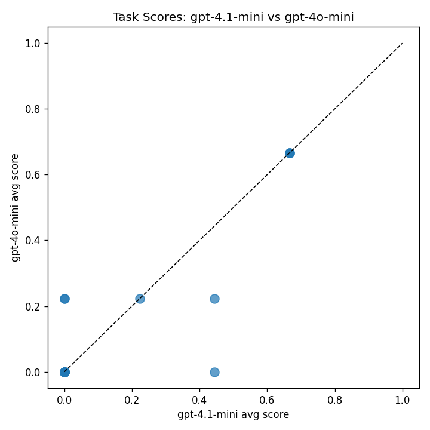
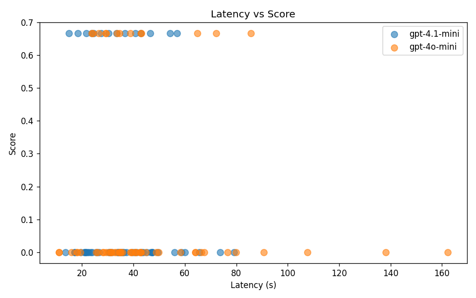

# BrowseComp LLM-as-a-Judge Eval

An evaluation harness for BrowseComp-style tasks: questions that require searching the web to find a precise answer. Each model answers with web search and page-fetch tools, and an LLM judge grades the answer against a per-task rubric.

## Setup

- 20 tasks, 2 models (`gpt-4o-mini`, `gpt-4.1-mini`), 3 samples per task → 120 runs
- Models run an agentic loop with two tools: `web_search` and `fetch_url`
- Judge: `gpt-4o`, temperature 0, scores each rubric criterion; the task score is the fraction of criteria met

## Results

| Model | Mean score | 95% CI |
|---|---|---|
| gpt-4.1-mini | 0.156 | [0.089, 0.233] |
| gpt-4o-mini | 0.144 | [0.078, 0.222] |

- Per-task scores of the two models correlate at 0.86; pass/fail agreement (threshold 0.5) is 100%.
- Mean run-to-run standard deviation per task: 0.058 (gpt-4.1-mini), 0.077 (gpt-4o-mini).

| | |
|---|---|
|  |  |
|  |  |



## Files

- `browsecomp_eval.ipynb`: inference, judging, and analysis
- `make_notebook.py`: generates the notebook
- `results/`: figures

## Run

The task dataset is not included. Place it in the repo root as `n=20 Browsecomp data - BrowseComp n=20.csv`, with columns `Task ID, Domain, Workflow, Prompt, Rubric JSON`.

```bash
pip install -r requirements.txt
export OPENAI_API_KEY=...
jupyter notebook browsecomp_eval.ipynb
```

Web search uses DuckDuckGo via `ddgs` (no key needed). The full run makes 120 agentic model calls plus judging. Per-run results are saved to `results/browsecomp_eval_results.csv`, which is not committed.
